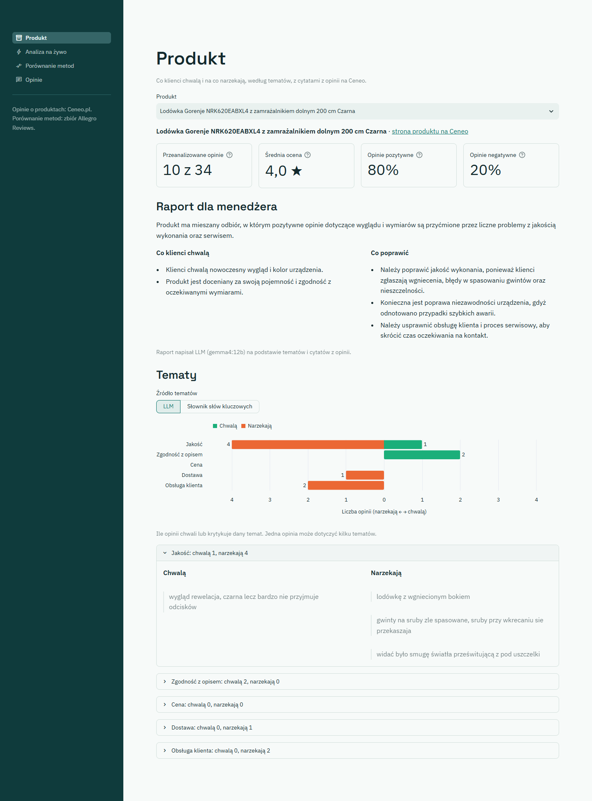
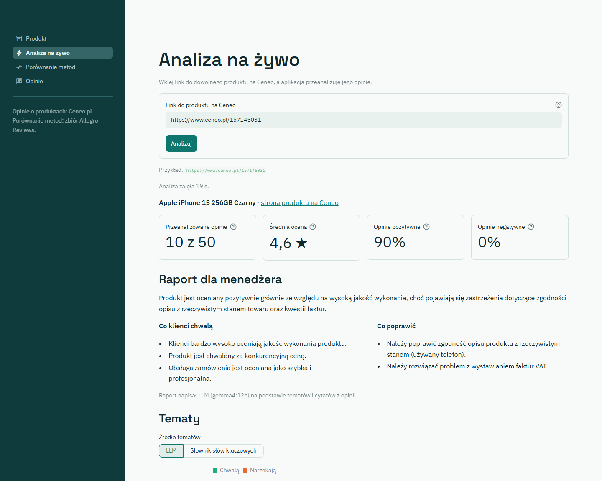
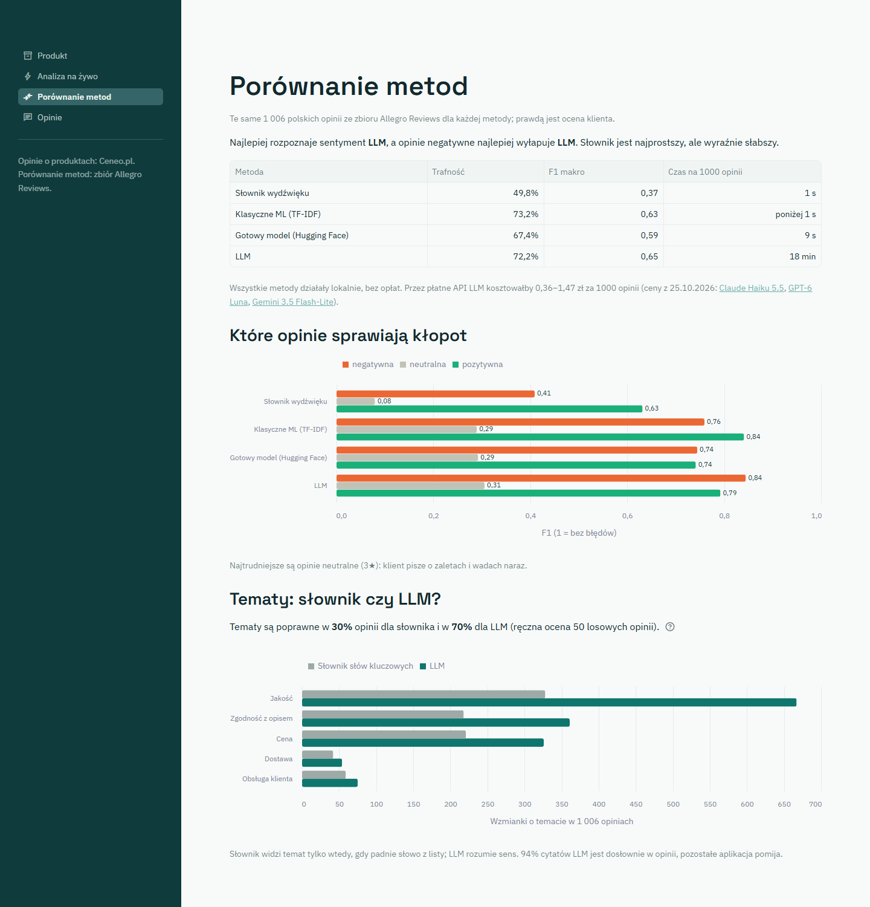
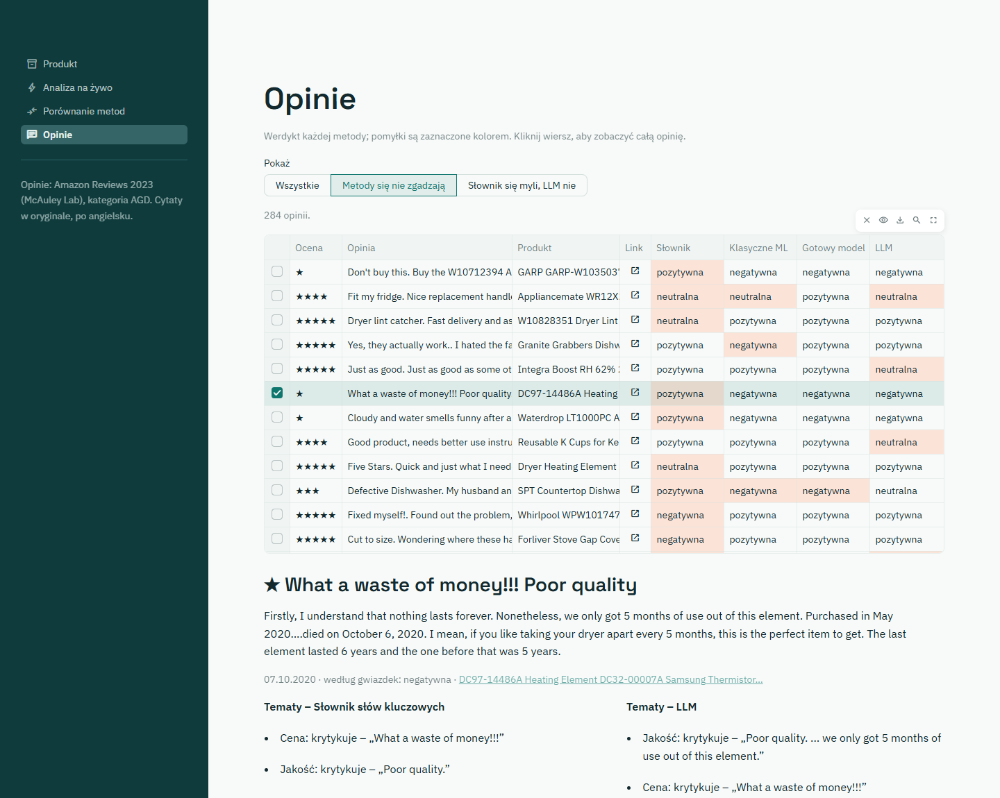

# Jak korzystać z Głosu Klienta

Głos Klienta czyta polskie opinie o produkcie i pokazuje, co klienci chwalą, a na co narzekają, w pięciu tematach:
**jakość**, **zgodność z opisem**, **cena**, **dostawa** i **obsługa klienta**. Do każdego tematu podaje cytaty
z opinii, a model językowy (LLM) pisze krótki raport dla menedżera. Aplikacja porównuje też cztery metody analizy,
od prostego słownika po LLM.

Opinie o produktach pochodzą z Ceneo.pl, a do porównania metod służy publiczny zbiór Allegro Reviews.
Jak uruchomić aplikację, opisuje [README](../README.md). Liczby w tym tutorialu dotyczą wyników zapisanych
w repozytorium (LLM: `gemma4:12b`).

## 1. Produkt

Wybierz jeden z 10 produktów demo z Ceneo. Dla każdego aplikacja przeanalizowała pierwszą stronę opinii,
czyli zwykle 10 opinii w kolejności wybranej przez Ceneo.

- **Kafelki** na górze: ile opinii przeanalizowano i ile ma produkt na Ceneo, średnia ocena oraz odsetek opinii
  pozytywnych (powyżej 3★) i negatywnych (poniżej 3★). Średnią wszystkich opinii z Ceneo pokazuje ikonka „?”.
- **Raport dla menedżera**: jedno zdanie o odbiorze produktu, zalety i rzeczy do poprawy. Pisze go LLM
  wyłącznie na podstawie tematów i cytatów z opinii. Gdy nikt niczego nie krytykuje, lista „Co poprawić” jest pusta.
- **Tematy**: wykres pokazuje, ile opinii chwali (zielone, w prawo) lub krytykuje (pomarańczowe, w lewo) każdy
  temat. Pod wykresem są rozwijane sekcje z cytatami.

**Spróbuj:**

1. Zostań przy lodówce Gorenje (10 z 34 opinii, 20% negatywnych). Najwięcej skarg dotyczy jakości (4 opinie).
   Rozwiń „Jakość”: klienci piszą np. „gwinty na sruby zle spasowane”. Narzekają też na obsługę klienta (2 opinie).
2. Przełącz „Źródło tematów” na **Słownik słów kluczowych**. Słownik znajduje tu tylko 3 wzmianki o tematach
   (LLM – 10): pomija zdania, w których nie zna żadnego słowa nacechowanego emocjonalnie.
3. Wybierz odkurzacz Jigoo C200 (same wysokie oceny: 9 opinii 5★ i jedna 4,5★). W „Co poprawić” jest tylko jedna uwaga, a klienci chwalą
   głównie cenę.

## 2. Analiza na żywo

Tu wklejasz link do dowolnego produktu na Ceneo. Aplikacja pobiera stronę produktu i liczy wszystko od nowa
dla opinii z jej pierwszej strony: cztery metody, tematy i raport. Wynik wygląda tak samo jak na ekranie Produkt.

- Działa tylko przy lokalnym uruchomieniu, z kartą graficzną i Ollamą. W Dockerze ekran wyjaśnia, czego brakuje.
- Kolejne strony opinii Ceneo otwiera tylko w przeglądarce, po automatycznym sprawdzeniu, czy to nie bot,
  więc analizujemy tylko pierwszą stronę.
- Analiza 10 opinii trwa ok. pół minuty. Pierwsza po dłuższej przerwie jest wolniejsza, bo Ollama musi wczytać model.

**Spróbuj:** wklej przykładowy link spod pola (Apple iPhone 15 256GB) i kliknij **Analizuj**. Zobaczysz 10 z 50
opinii ze średnią 4,6★. Raport wskaże jako problem zgodność z opisem i faktury – jeden klient dostał telefon,
który według rachunku był używany, i nie dostał faktury VAT.

**Ograniczenie LLM:** porównuj zalety z raportu z wykresem tematów. Zdarza się, że model wymienia jako zaletę
temat, który więcej opinii krytykuje, niż chwali. Raport warto czytać razem z liczbami i cytatami.

## 3. Porównanie metod

Cztery metody oceniają sentyment tych samych 1006 opinii z części testowej zbioru Allegro Reviews. Prawdą jest
ocena klienta: poniżej 3★ to opinia negatywna, 3★ neutralna, powyżej 3★ pozytywna.

| Metoda | Trafność | F1 makro | Czas na 1000 opinii |
|---|---|---|---|
| Słownik wydźwięku | 49,8% | 0,37 | 1 s |
| Klasyczne ML (TF-IDF) | 73,2% | 0,63 | poniżej 1 s |
| Gotowy model (Hugging Face) | 67,4% | 0,59 | 9 s |
| LLM | 72,2% | 0,65 | 18 min |

**Jak czytać wyniki:**

- Po polsku najlepiej wypada LLM (F1 makro 0,65), ale TF-IDF uczony na polskich opiniach jest prawie tak samo dobry
  (0,63) i liczy 1000 opinii w niecałą sekundę.
- Gotowy model z Hugging Face jest wielojęzyczny i nie był uczony na polskich opiniach, dlatego wypada słabiej.
- LLM najlepiej wyłapuje opinie negatywne (F1 0,84) i jako jedyny podaje tematy i cytaty.
- Wykres „Które opinie sprawiają kłopot” pokazuje F1 osobno dla każdej klasy. Najtrudniejsze są opinie
  neutralne (3★): klient pisze o zaletach i wadach naraz.
- Zdanie pod tabelą przelicza tokeny zużyte przez LLM na ceny trzech tanich modeli w chmurze: od 0,36 do 1,47 zł
  za 1000 opinii (linki prowadzą do cenników).
- Wykres „Tematy: słownik czy LLM?” pokazuje, że LLM znajduje więcej wzmianek o każdym temacie niż słownik,
  np. o jakości 667 zamiast 328 na 1006 opinii. Zdanie nad wykresem podaje wynik ręcznej oceny 50 losowych opinii:
  tematy są poprawne w 30% opinii dla słownika i w 70% dla LLM.

Dlaczego główną miarą jest F1 makro, a nie trafność, wyjaśnia ikonka „?” przy nagłówku kolumny.

## 4. Opinie

Opinie produktów demo z Ceneo z werdyktem każdej metody. Pomyłki (werdykt inny niż ocena klienta) są zaznaczone
kolorem. Kolumna **Produkt** podaje, czego dotyczy opinia, a ikonka w kolumnie **Link** otwiera stronę produktu
na Ceneo.

Przełącznik **Pokaż** filtruje tabelę:

- **Wszystkie**: 100 opinii,
- **Metody się nie zgadzają**: 52 opinie, w których co najmniej jedna metoda ma inne zdanie,
- **Słownik się myli, LLM nie**: 29 opinii.

**Spróbuj:** wybierz widok **Słownik się myli, LLM nie** i kliknij czwarty wiersz („Bardzo dobra jakość
wykonania…”, 5★, ekspres De'Longhi). Słownik uznał
opinię za negatywną, a w tematach zapisał krytykę jakości. Powód: słowo „dobra” sprowadził do rzeczownika „dobro”,
którego nie ma w słowniku, a „wykonania” do „wykonać”, które ma w słowniku ocenę −2. LLM rozumie sens zdania.

## Słowniczek

| Pojęcie | Znaczenie |
|---|---|
| Sentyment | Wydźwięk opinii: negatywna, neutralna albo pozytywna |
| Słownik wydźwięku | Lista polskich słów z oceną od −2 do 2 (IPI PAN); ocena opinii to suma ocen jej słów |
| Słownik słów kluczowych | Listy początków słów dla każdego tematu (np. „dostaw”, „kurier”, „paczk” dla dostawy); tania alternatywa dla LLM |
| Klasyczne ML (TF-IDF) | Model uczony na 9 577 opiniach z Allegro: uczy się, jakie słowa i pary słów pojawiają się przy danej ocenie |
| Gotowy model (Hugging Face) | Sieć neuronowa wytrenowana przez kogoś innego na opiniach o produktach, pobierana za darmo |
| LLM | Duży model językowy; tu działa lokalnie i oprócz sentymentu znajduje tematy i cytaty |
| Trafność | Jaka część opinii dostała dobrą ocenę |
| F1 makro | Średnia F1 z trzech klas; każda klasa liczy się tak samo, więc rzadsze opinie neutralne też mają znaczenie |
| Token | Kawałek tekstu, od którego liczy się cenę w płatnych API LLM |
| Cytat dosłowny | Cytat z LLM, który rzeczywiście jest w opinii; pozostałe aplikacja pomija |
